# AI.SDLC

[](https://github.com/RobHofmann/AI.SDLC/releases)
[](LICENSE)
[](https://github.com/microsoft/apm)
[](https://docs.anthropic.com/en/docs/claude-code)
[](https://github.com/features/copilot)

[](https://github.com/RobHofmann/AI.SDLC/actions/workflows/pr.yml)

A way of working in which an agent does the work and a person makes the calls. One set of skills, agents, hooks and gates, shared by every repository that installs it, and updated in one place.

## 📖 Documentation

**[Complete documentation](docs/index.md)**, in two layers:

- **[🧭 Functional documentation](docs-functional/index.md)**: what the AI.SDLC gives you, the packs, joining, taking a new version
- **[🔧 Technical documentation](docs/index.md)**: how the packages are built, the tools, the decisions (ADRs)

**Quick links:**
[The handbook](core/.apm/skills/ai-sdlc-handbook/references/README.md) · [The constitution](core/.apm/skills/ai-sdlc-handbook/references/constitution.md) · [Packs](docs-functional/packs.md) · [Joining](docs-functional/joining.md) · [Taking a new version](docs-functional/new-version.md) · [Releases](https://github.com/RobHofmann/AI.SDLC/releases)

## ✨ Why the AI.SDLC?

An agent writes code fast. Without a process it also skips the tests, forgets the docs and merges its own guesses. The AI.SDLC gives the agent a process and gives you two clear moments to decide.

- **Two human checkpoints, nothing in between.** You approve the story before it is written to the tracker (**Checkpoint Alpha**). You review the pull request (**Checkpoint Bravo**). Between the two, the agent plans, builds test-first, reviews, documents and opens the pull request on its own.
- **You stay in charge.** The agent shows you the evidence, and you make the call ([C09](core/.apm/skills/ai-sdlc-handbook/references/constitution.md)).
- **Gates that give the same answer everywhere.** Every check is a script that runs the same way in the pre-push hook, in the local pre-flight and in CI. Exit 0 passes, 1 fails, 2 says "could not check", and 2 never counts as a pass.
- **Docs that stay true.** Every repository has a technical and a functional layer of markdown, with a page for every part of the code. A gate keeps them one linked wiki ([C05](core/.apm/skills/ai-sdlc-handbook/references/constitution.md)).
- **Plain English.** A team member who is not a native speaker gets every page on the first read, and a gate checks it ([C11](core/.apm/skills/ai-sdlc-handbook/references/constitution.md)). Chat follows your language.
- **One source for every rule.** A rule is written once and linked from everywhere else, so two texts never disagree ([C12](core/.apm/skills/ai-sdlc-handbook/references/constitution.md)).
- **It learns.** When you correct the agent, the lesson goes to its durable home, proposed and never written in silence.
- **One place to fix a rule.** A shared fix is made here once. Each repository takes it with the next release, through an update pull request it opens itself.
- **It uses itself.** This repository installs its own packages from its own source, so every change here runs through the process it ships.

## 🧭 How it works

```mermaid
flowchart LR
    A[Issue] --> B[guide-me]
    B --> C[write-story + grilling]
    C --> D{{Checkpoint Alpha}}
    D --> E[implement]
    E --> F[walk the substrate]
    F --> G[plan]
    G --> H[build test-first]
    H --> I[gates + review agents]
    I --> J[wrap-up + pre-flight]
    J --> K[pull request]
    K --> L{{Checkpoint Bravo}}
    L --> M[merge]
```



Start any piece of work with `guide-me`. It reads where the work stands and names the next step.

## 📦 What is in it

| Package | What it brings | Who installs it |
|---|---|---|
| `core` | The workflow skills, the agents, the hooks, the core gates, the handbook and the shared CI step | Every repository |
| `github` | Pull requests, review threads, the feedback loop and GitHub Actions workflows | Every repository |
| `github-issues` | Stories and bugs as GitHub issues, and the gate that ties a pull request to its issue | Every repository |
| `discovery` | Research summaries, journey maps and hypothesis canvases, as markdown | Repositories with discovery work |
| `knowledge` | Short, sourced notes about how a system really behaves, kept in a private knowledge repository | Repositories that keep such notes |
| `dotnet` | C# conventions, test-first, the .NET gates and a local [Graphify](https://graphify.com) code graph | .NET repositories |
| `blazor` | Blazor component and authorization conventions | Blazor repositories |
| `bicep` | Bicep conventions and the Bicep pre-flight | Repositories with Bicep templates |
| `sonarcloud` | The SonarQube MCP server for the agent session | Repositories with a SonarCloud project |

## 🚀 Quick start

### Step 1: add `apm.yml`

Pin every package to the same release tag.

```yaml
dependencies:
  apm:
    - git: https://github.com/RobHofmann/AI.SDLC
      path: core
      ref: v1.0.0
    - git: https://github.com/RobHofmann/AI.SDLC
      path: packs/github
      ref: v1.0.0
    - git: https://github.com/RobHofmann/AI.SDLC
      path: packs/github-issues
      ref: v1.0.0
targets: [claude]
```

### Step 2: add `aisdlc.json` and install

`aisdlc.json` says where your docs, source and tests live. The [layout page](core/.apm/skills/ai-sdlc-handbook/references/layout.md) lists every field.

```bash
apm install
pwsh .claude/skills/ai-sdlc-hooks/scripts/Install-AiSdlc.ps1
```

Commit `apm.yml`, `apm.lock.yaml` and the installed files under `.claude/`. Every new clone runs `Install-AiSdlc.ps1` once.

### Step 3: start working

Open your agent in the repository and type `guide-me`. Or let the onboarding script do steps 1 and 2 for you: see [joining](docs-functional/joining.md).

📖 **[The handbook](core/.apm/skills/ai-sdlc-handbook/references/README.md)** · **[Your first story](core/.apm/skills/ai-sdlc-handbook/references/first-story.md)**

## 🔁 Day to day

| You want to | Type |
|---|---|
| Know the next step | `guide-me` |
| Write or refine a story | `write-story` |
| Build a refined story | `implement #42` |
| Fix a bug | `fix-bug #42` |
| Finish a change: tests, docs, commit, pre-flight | `wrap-up` |
| Work through review comments | `fix-pr-feedback` |
| Record a decision | `write-adr` |
| Hand over to a fresh session | `handoff` |

## 🔄 Taking a new version

A release tag opens a pull request in every repository that installs the AI.SDLC. It moves the pins to the new tag and lists what you must do before you merge. Installed files are read-only: a hook stops an edit, and the build fails on drift. A fix goes into this repository.

📖 **[Taking a new version](docs-functional/new-version.md)**

## 🤝 Contributing

Contributions are welcome. Start with [AGENTS.md](AGENTS.md): it holds the rules for changing a shared file without breaking a consumer.

- **[How AI.SDLC is built](docs/overview.md)**: the packages, the self-install and the workflow
- **[Tools](docs/tools.md)**: the scripts that check this repository and onboard a consumer
- **[Decisions](docs/adrs/README.md)**: why it is built this way

## 🏷️ Releasing

1. Every change has an issue with the `refined` label. Its pull request says `Refs #42`, not `Fixes #42`, so the merge leaves the issue open.
2. After the merge, tag `main` with an annotated tag whose message names the issue: `git tag -a v1.2.0 -m "Release v1.2.0 for #42"`. Do not start the message with `#`: git drops a tag message line that starts with `#`. Push the tag and publish a GitHub release on it.
3. Close the issue. Keep its `refined` label: an update pull request in a consumer names it as `Refs RobHofmann/AI.SDLC#42`, and the story check accepts a closed issue with that label.

AI.SDLC does not know its consumers, and pushes nothing to them. Each consumer pulls a release itself: its `ai-sdlc-update.yml` workflow opens an update pull request every Monday, and the `update-ai-sdlc` skill does the same on demand.

A new consumer joins with `pwsh tools/Add-AiSdlcConsumer.ps1 -TargetRepo <path>`. It writes the setup files and the update workflow in that repository. That workflow signs in as a GitHub App, which the consumer sets up once.

## 🤖 Which agents

The AI.SDLC is written for Claude Code and also works with GitHub Copilot CLI. The hooks read both payloads, and every hand-off to an agent has an inline fallback. APM installs it for other agents too, with fewer features.

## 📄 License

MIT. See [LICENSE](LICENSE). Parts adapted from other projects keep their own licence; see [THIRD-PARTY-NOTICES.md](THIRD-PARTY-NOTICES.md).

## 🙏 Credits

- [Microsoft APM](https://github.com/microsoft/apm) - the Agent Package Manager that installs it
- [mattpocock/skills](https://github.com/mattpocock/skills) - the grilling, handoff and wait-what skills, and several methods
- [humanlayer/skills](https://github.com/humanlayer/skills) - the "Merge danger" part of the evidence record
- [ECC](https://github.com/affaan-m/ECC) - the shape of several agents and the compact suggestion hook
- [i-have-adhd](https://github.com/ayghri/i-have-adhd) - ideas in the language rules
- [BMAD-METHOD](https://github.com/bmad-code-org/BMAD-METHOD) - the persona panel
- [CEFR-J Wordlist and the Octanove Vocabulary Profile](https://github.com/openlanguageprofiles/olp-en-cefrj) - the word lists behind the reading-level gate
- [Graphify](https://graphify.com) - the code graph
